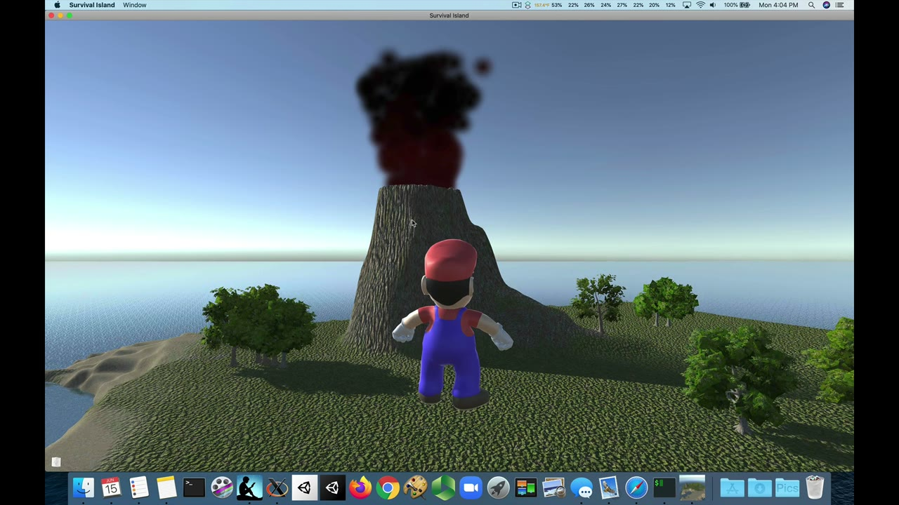
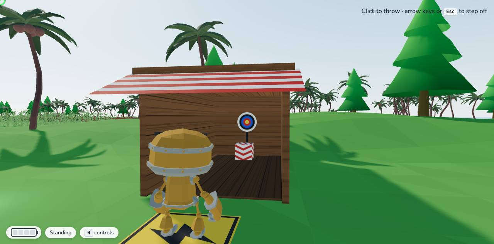
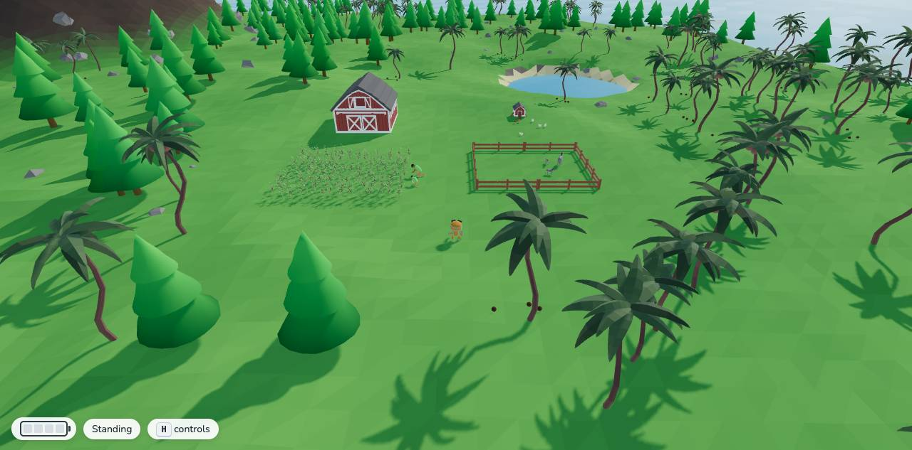
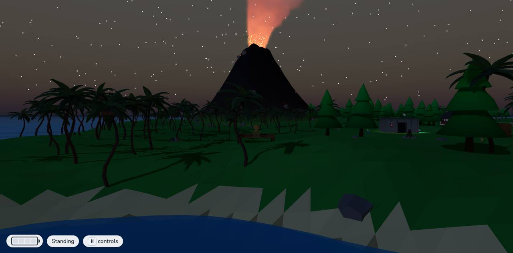
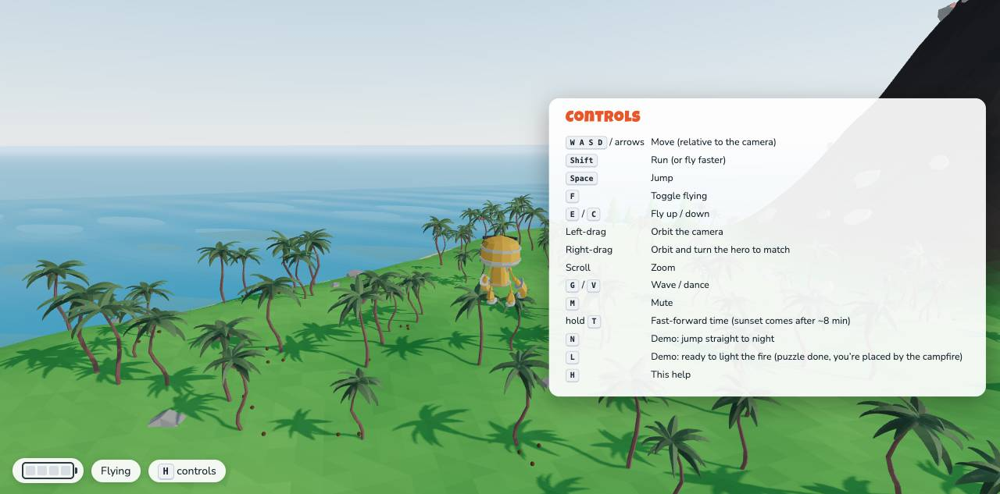

# 🏝️ Rebuilding *Survival Island* in a Day

Years ago I built *Survival Island* in Unity3D to show students how game pieces fit together: particle systems, walking characters, positional sound, trigger zones, a small puzzle. It took me weeks of Unity and Blender work. Many of you have seen the walkthrough video.

In a single day, Claude and I rebuilt it as a modern **browser game**: no install, just a link. Here's how.

*THE OLD VERSION: my original Unity game from years ago (from the walkthrough video). Everything below is the new one.*

## 👀 Step 1: Teaching the AI to watch a video

AI coding assistants can't watch video on their own. So we started by building a small **`/watch-video` skill**, inspired by a YouTube demo of the idea. It hands a video to Google's Gemini on its free tier, which watches it (picture, sound, and narration together) and reports back with timestamps.

We pointed it at my old walkthrough. Gemini produced a complete design breakdown: the island's layout, every character and animal, the full puzzle chain, the on-screen text, and what I said in my narration. Claude then pulled still frames at the key moments to check Gemini's description against the actual footage. That gave us an accurate spec to rebuild from. The skill is now a reusable tool for any YouTube link or local video.

## 🗺️ Step 2: Planning together

Before any code, we agreed on a plan in three phases, and on how each of my original teaching demos would map to a modern technique:

| Original lesson | Modern version |
|---|---|
| Volcano particle system | Thousands of particles computed on the graphics card, glowing red at night |
| Walking characters | Rigged, animated models with smooth blending between animations |
| Positional sound | Spatial audio, every sound generated in code (no audio files) |
| Voiced hints | Voices generated by Gemini text-to-speech, with subtitles |
| Coconut-throw minigame | Real projectile physics and a smooth camera swoop |

## 🛠️ Step 3: Building it in three phases

**Phase 1, the island:** procedural terrain, an animated sea and sky, a robot hero who walks, runs, jumps, and flies, and the smoking volcano.

**Phase 2, the puzzle:** the Site B bunker, two voiced characters who give hints, hidden power cells, the coconut booth, the matches, and lighting the campfire, finished with *Ode to Joy*.

*The coconut booth: step on the mat, aim, and knock the target down to win the last power cell.*

**Phase 3, the world:** palm trees along the coast, a farm with donkeys wandering their pen and chickens pecking by the coop, and a real sunset that turns into a starry night.

*The farm: barn, cornfield, the farmer and his son at work, and a donkey family in its pen.*

For the art, we used free public-domain 3D model packs (Quaternius, CC0). Claude converted them automatically with Blender and built an **"Asset Zoo"** page, where we could preview every model in the game's own lighting, right next to our hero, before choosing what to use. Much of the rest (the terrain, pine trees, buildings, chickens, textures, sounds, and music) is generated in code.

*Night falls: the volcano's plume glows red against the stars.*

## 🕹️ Playing it

You can walk, run, and jump around the island, or press **F** and **fly anywhere**: up over the volcano's crater, along the palm-lined coast, down to the farm to watch the donkeys. Press **H** at any time for the controls. When you're ready, the puzzle is waiting at the outpost: talk to the two castaways, find the power cells, win the coconut toss, and light the fire before night falls. Or just explore; nothing bad happens if you don't.

*Flying along the coast, with the controls panel open (press H).*

## 🤝 How we worked

- **We planned before building.** Claude laid out choices and I made the calls: which trees, which animals stand in for the pigs, whether the characters should be robots or people.
- **I play-tested; Claude tested too.** Claude ran the game in a hidden browser, played through the whole puzzle, and took screenshots to check its own work before handing each phase to me.
- **We froze each phase** as a playable snapshot, so the progression from bare island to finished game can still be shown side by side.

## 💡 Takeaways

- **The AI can now use video as input.** An old walkthrough became a design spec, and the skill works on any video.
- **The biggest saving wasn't typing speed.** It was skipping the tool wrangling: Unity setup, Blender modeling, exporting, and wiring assets together.
- **Free resources go a long way:** public-domain models, a free Gemini tier for watching video and generating voices, and a browser as the whole runtime.
- **Clear direction still matters.** The decisions were mine; the heavy lifting was Claude's.

Happy to show it live or answer questions about any part.

*-- Ralph*
